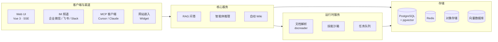

<div align="center">

# 企业智能管理平台

基于大语言模型的企业级知识管理与智能应用平台

汇集团队分散的文档资料，提供知识库问答、智能体推理与 Wiki 知识整理三种核心能力，三种能力共享同一知识库。

**快速问答** · **智能体** · **自动 Wiki** · **多渠道集成** · **私有化部署**

</div>

---

## 项目介绍

这是一款面向企业的知识管理平台，解决团队文档分散、检索困难、经验难沉淀的问题：

- **RAG 问答**：回答有据可查。关键词 + 向量混合检索、多模态文档解析、原文引用标注。
- **智能体**：用知识和工具完成任务。多步推理、技能与沙箱执行、MCP 工具接入、跨会话长期记忆。
- **Wiki 整理**：把文档自动整理成相互链接的 Wiki 页面，生成知识图谱，支持版本回滚。

除此之外：

- **记忆与知识整理**：跨会话长期记忆保存用户确认过的个人信息、偏好与事实；文件夹上传保留原始目录结构；检索分块可以编辑、比对与回滚。
- **数据源与格式**：飞书知识库 / 飞书云盘 / Confluence / GitLab / Notion / 语雀 / 钉钉文档 / Seafile / RSS 自动同步；覆盖 PDF、Word、图片、Excel、XMind 等十余种格式。
- **渠道与集成**：企业微信、飞书、Slack、Telegram 等 IM 频道内直接问答；网站嵌入 Widget 把智能体发布到外部站点；内置 MCP Server 供 Cursor、Claude 等 AI 工具连接；权限范围 API Key 用于程序化集成。
- **模型**：内置多家模型厂商接入，兼容 OpenAI、DeepSeek、Qwen（阿里云）、智谱、混元、Gemini、MiniMax、LiteLLM、Ollama 等。
- **权限与运维**：多空间 RBAC（四级角色、资源归属、空间审计日志）、任务队列面板与 Worker 池治理，通过 Langfuse 追踪智能体步骤与 Token 用量。
- **部署**：大模型、向量数据库、存储后端均可替换，支持本地与私有云部署，数据留在你自己的环境中。

## 快速开始

需要 [Docker](https://www.docker.com/)、[Docker Compose](https://docs.docker.com/compose/) 与 [Git](https://git-scm.com/)。

```bash
git clone <你的仓库地址>
cd <项目目录>
cp .env.example .env    # 按需编辑 .env，详见文件内注释
docker compose pull     # 拉取最新镜像
docker compose up -d    # 启动核心服务
```

启动成功后访问 **[http://localhost](http://localhost)**，按新手引导完成配置即可使用。

> [!TIP]
> 如需使用本地 Ollama 模型，请先运行 `ollama serve > /dev/null 2>&1 &`。Ollama 向量模型名与 `OLLAMA_BASE_URL` 配置见 `.env` 文件内注释。

| 服务 | 地址 |
|------|------|
| Web UI | `http://localhost` |
| 后端 API | `http://localhost:8080` |
| 链路追踪 (Langfuse) | `http://localhost:3000` |

### 可选服务

按需添加 `--profile` 启动额外组件，多个 profile 可叠加使用：

| Profile | 说明 |
|---------|------|
| _(默认)_ | 核心服务 |
| `full` | 全部功能 |
| `neo4j` | 知识图谱 (Neo4j) |
| `minio` | 对象存储 (MinIO) |
| `langfuse` | 链路追踪 (Langfuse) |

```bash
docker compose --profile neo4j --profile minio pull
docker compose --profile neo4j --profile minio up -d
docker compose down     # 停止服务
```

### 版本升级

```bash
docker compose pull     # 拉取最新镜像
docker compose up -d    # 用新镜像重建容器
```

### 其他部署方式

| 方式 | 适用场景 |
|------|----------|
| **Docker Compose** | 上面的标准部署，功能完整，多服务 |
| **Kubernetes (Helm)** | 生产集群；Chart 位于 [`helm/`](./helm) |
| **Lite 单二进制** | 本机或低资源环境，零外部依赖（SQLite + 内存队列）；与标准版的差异见 [Lite 与标准版区别](./docs/LITE.md) |
| **桌面应用** | 带图形界面的 Lite 运行时，免登录启动，macOS 上提供本机沙箱；需自行构建 |

> [!WARNING]
> 平台已提供登录鉴权，但在生产环境部署时，强烈建议：
> - 将服务部署在内网 / 私有网络环境中，而非公网环境；
> - 避免将服务直接暴露在公网上，以防止重要信息泄露风险；
> - 为部署环境配置适当的防火墙规则和访问控制；
> - 定期更新到最新版本以获取安全补丁和改进。

## 架构设计



从文档解析、向量化、检索到大模型推理，各环节模块化解耦，组件可替换、可扩展。支持本地与私有云部署，Web UI 开箱即用。

## 功能概览

| 领域 | 要点 |
|------|------|
| 问答与智能体 | 快速问答基于知识库作答并附来源引用；智能推理由 ReAct 智能体编排知识库、网络搜索、MCP 工具、技能与本机浏览器。进行中的对话可以补充要求、分叉或回滚，并支持跨会话长期记忆 |
| Wiki | 智能体生成相互链接的 Wiki 页面与知识图谱；支持浏览器内编辑、版本 diff 与回滚 |
| 技能与沙箱 | 技能目录支持从 Git / ZIP 安装；会话级持久的 Docker / E2B / Cube 沙箱，按配置设置网络策略；对话旁提供交互式终端与图形桌面 |
| 知识库 | FAQ、文档、Wiki 三类知识库；文件夹树；分块编辑与版本历史；按批次设置解析、分块与多模态；自动打标签 |
| 检索 | 关键词 + 向量混合检索、重排序、父子分块与 GraphRAG（Neo4j）；端到端评测召回命中率与 BLEU / ROUGE |
| 权限与安全 | 空间 RBAC 四级角色与审计日志；权限范围 API Key；OIDC；凭据 AES-256-GCM 加密；防 SSRF 的出站请求与仅白名单出站模式 |
| 运维 | Langfuse 追踪智能体步骤、Token 用量与任务流水线；文档解析时间线；带 Worker 池的任务队列面板；版本升级自动迁移数据库 |

### 支持的组件

| 组件 | 可选项 |
|------|--------|
| 模型厂商 | OpenAI / Azure OpenAI / Anthropic / DeepSeek / Qwen（阿里云）/ 智谱 / 混元 / 豆包（火山引擎）/ Gemini / MiniMax / NVIDIA / SiliconFlow / OpenRouter / LiteLLM / Ollama |
| Embedding | Ollama / BGE / GTE / 智谱 / OpenAI 兼容接口 |
| 向量数据库 | PostgreSQL (pgvector) / Elasticsearch / OpenSearch / Milvus / Weaviate / Qdrant / Apache Doris / 腾讯云 VectorDB |
| 对象存储 | 本地 / 腾讯云 COS / MinIO / AWS S3 / 火山引擎 TOS / 阿里云 OSS / 金山云 KS3 / 华为云 OBS |
| 文档格式 | PDF / Word / PPT / Excel / CSV / TXT / Markdown / HTML / EPUB / MHTML / JSON / XMind / 图片 |
| 数据源 | 飞书知识库 / 飞书云盘 / Lark / Confluence / GitLab / 腾讯 IMA / Notion / 语雀 / 钉钉文档 / Seafile / RSS |
| IM 渠道 | 企业微信 / 飞书 / Lark / QQBot / Slack / Telegram / 钉钉 / Mattermost / 微信 / 云之家 |
| 网络搜索 | DuckDuckGo / Bing / Google / Tavily / Baidu / SearXNG / Exa / 博查 / Serply |
| 部署 | Docker Compose / Kubernetes (Helm) / Lite 单二进制 / 桌面版；支持离线与私有云部署；界面支持中文、英文、日文、韩文、俄文 |

## 客户端与集成

| 客户端 | 用途 |
|--------|------|
| **内置 MCP Server** | 通过 Streamable HTTP 把知识库开放给 Cursor、Claude 等 MCP 客户端 |
| **微信小程序**（[`miniprogram/`](./miniprogram/README.md)） | 轻量移动端：选择知识库、导入 URL，在微信内向知识库提问 |
| **Go SDK** | 知识库、文档、会话等资源的 CRUD 与 SSE 流式问答 |

## 开发指南

频繁修改代码时不需要每次重新构建 Docker 镜像，使用快速开发模式即可：

```bash
make dev-start      # 启动基础设施
make dev-app        # 启动后端（新终端）
make dev-frontend   # 启动前端（新终端）
```

- 前端修改自动热重载（无需重启）
- 后端修改快速重启（5-10 秒，支持 Air 热重载）
- 无需重新构建 Docker 镜像
- 支持 IDE 断点调试

## 贡献指南

欢迎通过 Issue 反馈问题或提交 Pull Request。

- **流程：** Fork → 新建分支 → 提交更改 → 创建 PR
- **规范：** 使用 `gofmt` 格式化代码，遵循 [Conventional Commits](https://www.conventionalcommits.org/) 提交（`feat:` / `fix:` / `docs:` / `test:` / `refactor:`）

<details>
<summary><b>验证方式</b></summary>

<br/>

对于范围集中的改动，优先验证本次改动涉及的文件和包：

```bash
git fetch origin main
git diff --check origin/main...HEAD
golangci-lint run --new-from-rev=origin/main ./...
go test ./path/to/changed/package -count=1
```

提交前请对改动过的 Go 文件运行 `gofmt`。对于前端改动，请在 `frontend/` 目录运行相关测试；如果改动涉及 TypeScript 或 Vue 组件，还应运行 `npm run type-check`。

全仓验证命令：

```bash
make fmt
make lint
make test
```

`make fmt` 会格式化整个 Go 仓库，因此请仅在工作区干净时运行，并检查产生的 diff。

</details>

## 许可证

本项目基于 [MIT](./LICENSE) 协议发布。你可以自由使用、修改和分发本项目代码，但需保留原始版权声明。
